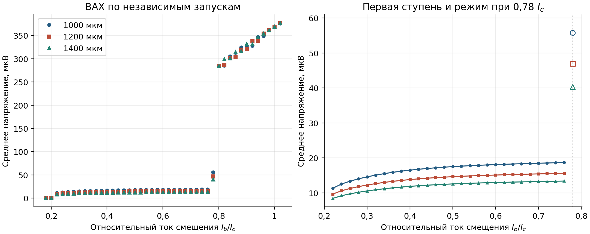
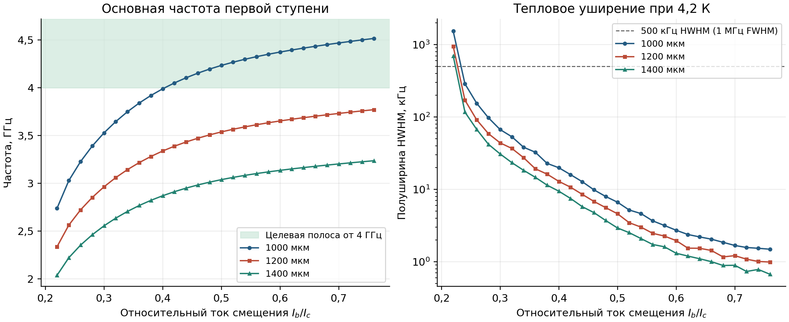
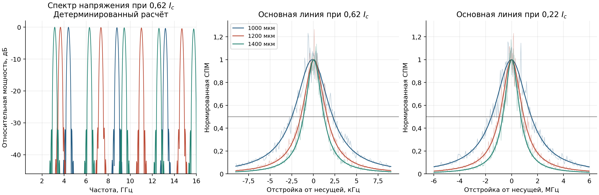
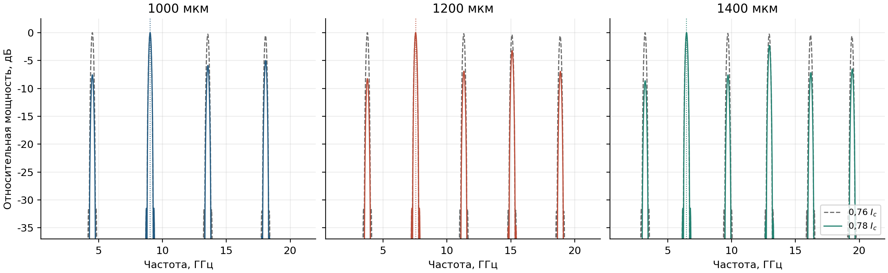

# Моделирование длинных джозефсоновских переходов

Рассчитаны вольт-амперные характеристики и спектры напряжения на выходе трёх длинных джозефсоновских переходов длиной 1000, 1200 и 1400 мкм. На первой ступени нулевого поля определены диапазоны перестройки основной частоты и тепловая полуширина линии.

## Условия расчёта

Переход моделировали дискретной цепочкой RCSJ шириной 5 мкм с индуктивной связью между соседними элементами. Расчёты выполнены в Python при нулевом внешнем поле и равномерном токе смещения. На правом краю через индуктивность одного участка цепочки подключали резистор 50 Ом. Диапазон $I_b/I_c$ составлял 0,18–1,02 с шагом 0,02. В каждой точке независимо задавали один начальный флаксон в центре перехода. [Параметры модели](data/settings.json)

Режим первой ступени определяли по регулярным импульсам на нагрузке и набегу фазы около $4\pi$ за период в центре перехода. Основную частоту получали по интервалу между импульсами и сверяли с пиком спектра напряжения. Для расчёта полуширины использовали 64 реализации теплового фазового шума при 4,2 К. Шум Джонсона–Найквиста шунтов и нагрузки учитывали через фазовую чувствительность, а полуширину находили лоренцевой аппроксимацией усреднённого спектра огибающей. [Метод фазовой чувствительности](https://doi.org/10.1109/81.847872)

## Основные результаты

Из 129 запусков 84 вышли на первую ступень. Для каждой длины она получена в 28 расчётных точках при $I_b/I_c$ от 0,22 до 0,76. Это диапазон для выбранных начальных условий.

| Длина, мкм | Основная частота, ГГц | Размах перестройки, МГц | Частота при $0{,}62I_c$, ГГц | Мощность при $0{,}62I_c$, пВт | Полуширина при $0{,}62I_c$, кГц |
|---:|---:|---:|---:|---:|---:|
| 1000 | 2,739–4,517 | 1777 | 4,395 | 13,09 | 2,38 |
| 1200 | 2,337–3,771 | 1434 | 3,670 | 9,16 | 1,54 |
| 1400 | 2,037–3,236 | 1199 | 3,151 | 6,76 | 1,20 |

## Графики

### Вольт-амперные характеристики

[Полная ВАХ](figures/panels/iv_full.png) · [Первая ступень в мА и мкВ](figures/panels/iv_first_step.png)

### Перестройка и полуширина

HWHM обозначает полуширину на половине максимума мощности. Полная ширина FWHM вдвое больше. На правой панели шкала полуширины логарифмическая. [Основная частота](figures/panels/tuning_f1.png) · [Тепловая полуширина](figures/panels/thermal_hwhm.png)

### Спектры выходного сигнала

Широкополосный спектр показывает частоты гармоник. В профилях основной линии тонкими линиями показаны усреднённые шумовые спектры, сплошными — их лоренцевы аппроксимации. [Широкополосный спектр](figures/panels/spectrum_062_wideband.png) · [Основная линия при $0{,}62I_c$](figures/panels/line_062.png) · [Основная линия при $0{,}22I_c$](figures/panels/line_022.png)

### Режим при $0{,}78I_c$

При $0{,}78I_c$ среднее напряжение для каждой длины примерно втрое выше, чем при $0{,}76I_c$. Наиболее мощные пики расположены около 9,04, 7,55 и 6,48 ГГц для 1000, 1200 и 1400 мкм соответственно. Сигнал повторяется с удвоенным периодом доминирующего пика. Это согласуется с режимом более высокой ступени. Оценка полуширины и проверка управляемого переключения для этого режима требуют отдельного расчёта. [Диагностика режима](data/diagnostic_078.csv) · [1000 мкм](figures/panels/mode_1000um.png) · [1200 мкм](figures/panels/mode_1200um.png) · [1400 мкм](figures/panels/mode_1400um.png)
